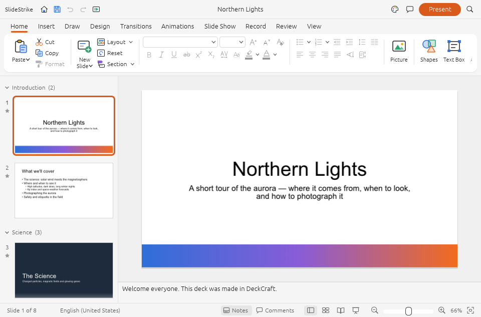
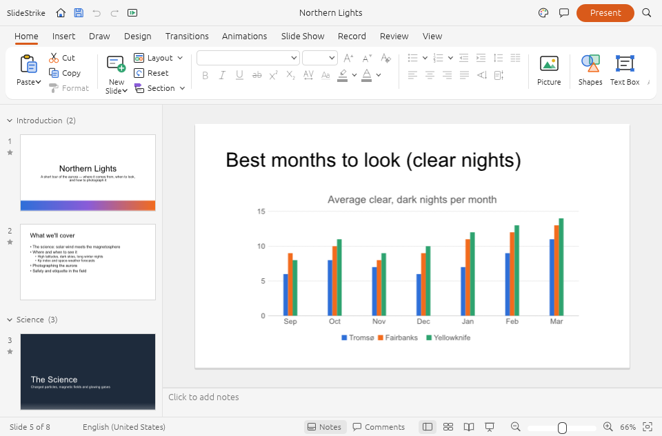

<p align="center">
  
</p>

<h1 align="center">SlideStrike</h1>

<p align="center">
  <a href="https://prowebdevsolutions.com"><picture>
    <source media="(prefers-color-scheme: dark)" srcset="assets/branding/PWDS-logo-orange.svg">
    
  </picture></a>
</p>

<p align="center"><strong>Build the story one slide at a time.</strong></p>

SlideStrike lets you build editable decks with text, images, and speaker notes. This repository preserves the original `.sstrike` prototype and adds a fuller native presentation foundation with a desktop editor, rendering, media, and export paths, based on a pinned DeckCraft source revision.

## Rust direction and migration status

- **Target:** Adapt and extend the existing Rust DeckCraft foundation into SlideStrike, rather than rewrite an already-Rust presentation engine.
- **Current implementation:** Published `main` contains the Rust model/PPTX/render/media/editor graph in [`native/slidestrike`](native/slidestrike/), plus the original Rust `.sstrike` prototype in [`apps/slidestrike`](apps/slidestrike/) and an explicit legacy import path.
- **Remaining migration:** Consolidate on the DeckCraft-based desktop while retaining legacy-file support and existing fixes. Broad PPTX fidelity, animation playback, native interaction, accessibility, and release packaging remain open; a bounded backport or sample capture is not PowerPoint parity.



The native presentation foundation on Windows, displaying its built-in public **Northern Lights** sample. This original native capture was recorded on 22 October 2026 from the same native application source as main `0931f68`. See [capture provenance and runtime evidence](docs/NATIVE_RUNTIME_ACCEPTANCE.md). The [older lightweight editor screenshot](assets/screenshots/slidestrike-editor.png) and [historical import/save capture](assets/screenshots/archive/slidestrike-native-b66faf4.png) are preserved separately.

<p align="center"><a href="#highlights">Highlights</a> · <a href="#build-and-test">Build and test</a> · <a href="assets/branding">Original artwork</a></p>

## Highlights

- Arrange text and image objects on slides.
- Save an editable `.sstrike` deck with notes.
- Present or export pages as PNG or PDF.
- Explore a fuller native presentation model, PPTX paths, rendering, media, and an egui desktop editor in `native/slidestrike`.

## Current status

The original standalone package passed 21 locked tests at an earlier checkpoint. Its lightweight editor built offline and rendered an [archived screenshot of the legacy interface](docs/SCREENSHOT_PROVENANCE.md). The native foundation [built and passed Windows checks at capture source `34bb844`](https://github.com/Gerbzz/SlideStrike/actions/runs/39694465493): embedded geometric icon payloads, media guards and formats, legacy import/save, destination protection, CLI and MCP identity. That executable also rendered the public eight-slide sample, captured its title and chart views, and exited cleanly. The earlier synthetic legacy import/save/reopen runtime check remains [documented with its exact source and limits](docs/NATIVE_RUNTIME_ACCEPTANCE.md). No installer or release is supplied. Broader native interaction, accessibility, and presentation fidelity remain unverified.

| Path | Role |
| --- | --- |
| `apps/slidestrike` | Original editor and `.sstrike` archive reader/writer. |
| `native/slidestrike` | Full adapted model, PPTX, render, engine, media, and desktop UI source graph; desktop build, focused tests, and a synthetic import/save/reopen runtime check passed on Windows. |
| `fixtures/slidestrike` | Small synthetic inputs for the original tests and the new import regression test. |

The native graph retains its internal `deckcraft-*` crate names and `.deckcraft` file format so its model, format, engine, and UI remain coherent. Its desktop executable is named `slidestrike`. The older DesignCraft page export subset supports only the original prototype.

## Deck and exported pages



The sample's fifth slide in the same native Windows session. The chart, ribbon and slide navigation are original application-rendered pixels; [the capture proof](assets/screenshots/native-2026-10-22/proof.json) records source and image hashes.

A `.sstrike` deck keeps slide objects and speaker notes editable. PNG and PDF exports contain the presented pages; notes stay in `.sstrike` and are omitted from those exports. The bounded export check used three small synthetic slides, so wider layout fidelity remains open.

The native `Import Older Strike Deck` command converts an existing `.sstrike` archive into an **unsaved** presentation. It checks old archive contents, maps slide objects and notes, and reports any required font substitution. Save As must use a new `.deckcraft` or `.pptx` path; native writes to `.sstrike` are refused to protect the original file. Import resets old undo history and regenerates object IDs. The native draft now keeps an imported deck marked unsaved until Save As so its close guard can prompt. Wider visual and fidelity validation is pending.

## Build and test

Use Rust 1.90 or newer and a supported native compiler toolchain. Cargo may need to fetch dependencies. From the repository root:

```powershell
cargo test --locked --manifest-path apps/slidestrike/Cargo.toml --all-features
cargo build --locked --manifest-path apps/slidestrike/Cargo.toml --bin slidestrike-native --features native-ui

# Native foundation (run its broader engine tests and desktop build)
cargo test --locked --manifest-path native/slidestrike/Cargo.toml -p deckcraft-engine
cargo build --locked --manifest-path native/slidestrike/Cargo.toml -p deckcraft --bin slidestrike
```

The app has its own `Cargo.lock` and `[workspace]`. Its path dependencies resolve to `vendor/designcraft-page`, whose eight selected Rust crates, needed fonts, hyphenation data, ICC profile, upstream licenses, and notices are included. Synthetic image and deck fixtures live in `fixtures/slidestrike` at their tested relative paths. Cargo fetches the remaining dependencies from crates.io.

## Limits and source terms

The synthetic export checks covered three small slides with visible text and image placement. The historical native runtime check covered one three-slide legacy import and native save/reopen; the current hosted capture covers two views of the public eight-slide sample. Native pointer, keyboard, screen reader, high contrast, scaling, presentation controls, font fallback, PPTX losses, broader media, recovery, and other-platform acceptance are pending. No PowerPoint parity claim is made.

The app's first-party license has not been selected; no first-party license grant is made here. The bundled upstream DesignCraft subset retains its original MIT/Apache license texts and third-party notices. The native graph is adapted from [`storytold/deckcraft` commit `be14248577b92059eb2b8c0c9460cceffbc1f01d`](https://github.com/storytold/deckcraft/commit/be14248577b92059eb2b8c0c9460cceffbc1f01d), with its MIT/Apache licenses, notice, and attribution. The included Source Serif 4 original retains its OFL notice. See [SOURCE_SCOPE.md](SOURCE_SCOPE.md) and [native source adaptation](native/slidestrike/ADAPTATION.md). Review dependency notices, including Symphonia's MPL-2.0 terms, before distributing binaries.

## PWDS brand artwork

The company mark in this masthead is the existing [official PWDS logo](https://github.com/Gerbzz/PWDS-Website/blob/main/public/prowebdevsolutions-logo.png), with the [official orange display asset](https://prowebdevsolutions.com/images/prowebdevsolutions-logo-orange.svg) for dark backgrounds. The app logo above it remains the original Strike suite artwork.

The original geometric SlideStrike mark, preserved historical peacock artwork and PWDS artwork are separate brand assets; no public license for those marks is granted here.

