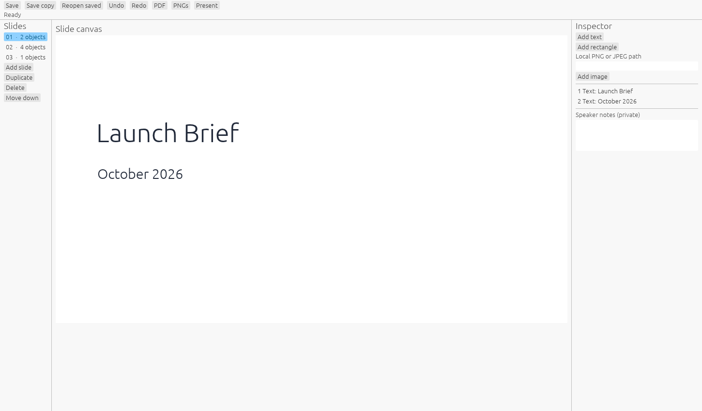

# SlideStrike editor screenshot provenance

*Archived lightweight editor. This is not a screenshot of the newer native foundation in [draft PR #1](https://github.com/Gerbzz/SlideStrike/pull/1).*

`assets/screenshots/slidestrike-editor.png` is an uncomposited 1450 × 850 image returned by the lightweight SlideStrike Windows editor's one-shot `--capture` option on October 14, 2026. SHA-256: `9D837789D0087774E3C4A2C464841AD7DAF280EF7FDF94783B6FB58FFBD12ABF`. The app exited with status 0 and the image was visually inspected.

The editor opened a self-authored local `.sstrike` deck with three slides titled **Launch Brief**. The first slide contains the title and an October 2026 subtitle; another includes fictional pilot counts. The fixture is not distributed with this repository, and the screenshot contains no client material or personal workstation path.

The executable was built offline with one Cargo job from the public main source plus the two capture changes now included here: `apps/slidestrike/src/native_ui.rs` and `apps/slidestrike/src/bin/slidestrike-native.rs`. The build completed in 14.79 seconds using an existing target cache. The executable's SHA-256 is `9019EDB8279FFD0E57AF959A4900ED9C46F1BB147DD233A31BCEB23F3C0D1AF4`. Of its 110 tracked source inputs, 108 matched the public main base exactly; the two differences were the capture files copied into this commit. The capture uses the native egui/eframe Glow renderer and creates the PNG without overwriting an existing file.

This checks that the lightweight editor starts, opens the synthetic deck, paints a frame, and writes a PNG. It does not test mouse or keyboard editing, save/reopen, export, accessibility, or the newer [native foundation draft](https://github.com/Gerbzz/SlideStrike/pull/1). The draft's source CI result is separate from this screenshot and does not establish a visually accepted runtime.
